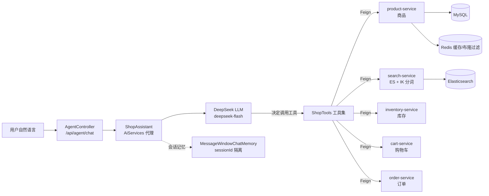

# smartmall-agent —— SmartMall LLM 智能体层

基于 **LangChain4j + DeepSeek** 的电商智能体服务，通过 **Function Calling** 把 SmartMall 的商品能力编排成 LLM 可调用的工具，
用户用自然语言即可完成商品搜索、详情查询、库存查询。

这是 SmartMall 从「传统微服务电商」升级为「LLM 智能体驱动的电商平台」的核心模块。

## 一、技术栈

| 层 | 技术 |
|---|---|
| LLM 编排 | LangChain4j 1.22.0（AiServices / ReAct 工具编排） |
| 模型 | DeepSeek（deepseek-flash，OpenAI 兼容协议，可切换任意 OpenAI 兼容模型） |
| 对话记忆 | MessageWindowChatMemory（按 sessionId 隔离的多轮上下文） |
| 服务调用 | OpenFeign + Nacos 服务发现（真实调用 product-service） |
| 服务框架 | Spring Boot 3.5.4 + Spring Cloud Alibaba |
| 统一响应 | smartmall-common 的 Result / ResultCode |

## 二、架构



**核心流程**：LLM 收到自然语言 → 思考 → 决定调用哪个工具并生成参数 → 工具通过 Feign 真实调用商品微服务 → LLM 整合数据生成回复。

## 三、目录结构

```
smartmall-agent/
├── pom.xml
└── src/main/
    ├── java/com/smartmall/agent/
    │   ├── SmartmallAgentApplication.java   # 启动类（排除本模块用不到的数据源/Redis 自动配置）
    │   ├── agent/ShopAssistant.java         # AiServices 接口 + 系统人设
    │   ├── config/LangChain4jConfig.java    # LLM 模型 Bean + 记忆 Provider
    │   ├── controller/AgentController.java  # /api/agent/chat 入口
    │   ├── controller/AgentExceptionHandler.java
    │   ├── dto/ChatRequest.java
    │   ├── feign/ProductFeignClient.java    # 商品服务 Feign 客户端
    │   └── tool/
    │       ├── ShopTools.java               # @Tool 工具集（真实调 product-service）
    │       └── ProductInfo.java             # 工具返回给 LLM 的结构
    └── resources/
        ├── application.yml                  # 端口 + LLM 配置
        └── bootstrap.yml                    # Nacos 注册（agent-service）
```

## 四、快速开始

### 前置条件

- JDK 17+、Maven 3.9+
- DeepSeek API Key（或任意 OpenAI 兼容接口的 Key）
- 运行中的基础设施：MySQL、Redis、Nacos（Docker 容器）
- 运行中的 product-service

### 完整运行（接入真实微服务）

```bash
# 1. 启动基础设施容器
docker start mysql redis nacos

# 2. 启动商品服务（8083）
mvn -pl smartmall-product spring-boot:run

# 3. 启动智能体服务（8092）
export DEEPSEEK_API_KEY=sk-xxxxxxxx
mvn -pl smartmall-agent spring-boot:run
```

接入网关后，统一从 `http://localhost:8088/api/agent/chat` 访问。

### 前端聊天界面

agent 服务内置了一个可直接使用的 Web 聊天界面（同源托管，无需额外构建）：

- 浏览器打开 `http://localhost:8092/`
- 支持多轮对话、快捷问题、Markdown 渲染、会话重置
- 前端代码位于 `src/main/resources/static/index.html`

### 独立快速验证（不依赖 Nacos/微服务，工具会降级为空结果）

```bash
export DEEPSEEK_API_KEY=sk-xxxxxxxx
mvn -pl smartmall-agent spring-boot:run \
  -Dspring-boot.run.arguments="--spring.cloud.nacos.discovery.enabled=false --spring.cloud.nacos.config.enabled=false"
```

> 该模式仅用于验证 LLM 对话/编排本身；工具因拿不到微服务数据会返回空列表。

## 五、API 说明

### POST /api/agent/chat

请求体：

```json
{
  "sessionId": "可选，不传则服务端自动生成（用于多轮对话记忆隔离）",
  "message": "帮我找一款手机"
}
```

响应：

```json
{
  "code": 200,
  "message": "操作成功",
  "data": "商城目前搜索到的在售手机主要是……"
}
```

### 已实现的工具（Tools，真实调用 product-service）

| 工具 | 说明 | 对应微服务接口 |
|---|---|---|
| `searchProducts(keyword)` | 按关键词搜索商品（ES + IK 中文分词） | `GET /api/search` |
| `getProductDetail(productId)` | 查询单个商品详情 | `GET /api/product/{id}` |
| `getStock(productId)` | 查询商品库存 | `GET /api/inventory/{productId}`（缺数据回退商品服务） |
| `listCart(userId)` | 查询购物车 | `GET /api/cart/{userId}` |
| `addToCart(userId, productId, quantity)` | 加入购物车 | `POST /api/cart` |
| `queryOrder(orderId)` | 查询订单 | `GET /api/order/{id}` |
| `previewOrder(...)` | 生成下单预览（护栏第一步） | 本地草稿 + 商品服务 |
| `confirmOrder(confirmCode)` | 确认下单（护栏第二步） | `POST /api/order` |

## 六、当前状态与下一步规划

**已跑通（8 个工具全部真实编排微服务）**：
`自然语言 → DeepSeek LLM → Function Calling → Feign → product/search/inventory/cart/order-service(Nacos) → MySQL/Redis/ES`

- 商品搜索走 **search-service（Elasticsearch + IK 中文分词）**
- 下单走 **order-service（护栏：预览 → 用户确认 → 正式下单）**，下单后经 RocketMQ 异步扣减库存
- 多轮对话记忆按 sessionId 隔离

**可选增强（后续）**：
1. RAG 向量检索：商品描述 embedding 化 + ES `dense_vector`（需额外的 embedding 模型，DeepSeek 不提供 embedding API）
2. MCP Server：把工具暴露为 MCP，供外部 Agent 客户端调用
3. 可观测性：工具调用链路接入 Zipkin；评测集量化工具选择正确率
4. 工具错误处理：配置 LangChain4j 的 ToolErrorHandling
